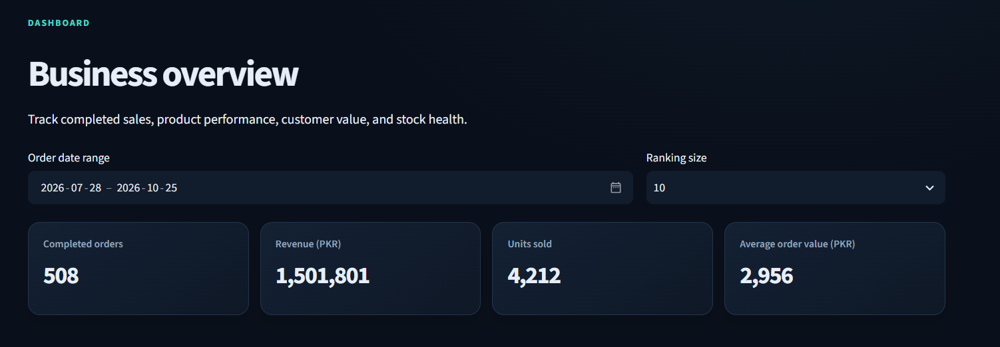
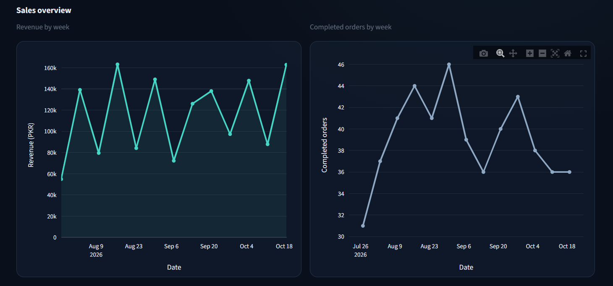
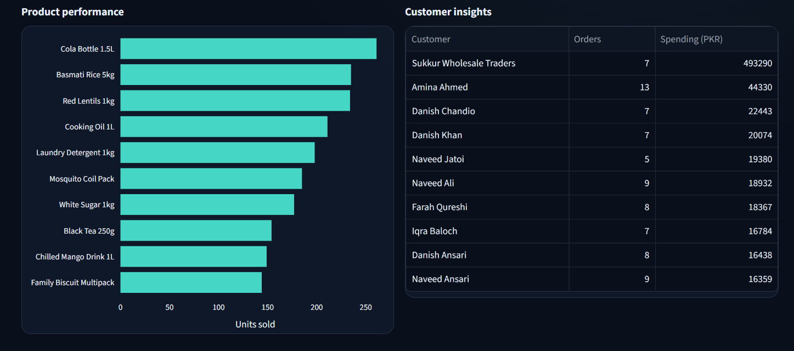
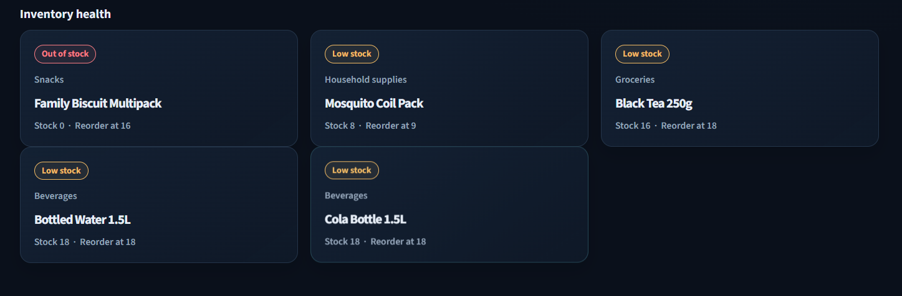
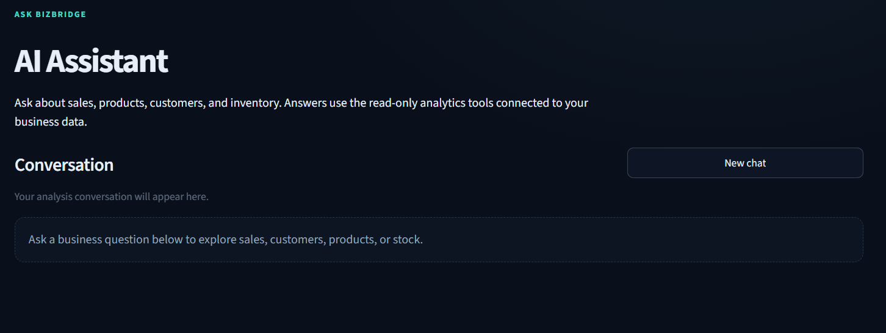

# BizBridge AI

SQLite schema, deterministic synthetic general-store data, read-only analytics,
a local MCP server, and a provider-independent analytics agent for a fictional
shop in Sukkur, Pakistan. It also includes a Streamlit dashboard and AI
Assistant interface. The dataset contains only fictional people and whole-PKR
prices.

## Screenshots

### Dashboard

Key business metrics for completed orders, revenue, units sold, and average order value, with an adjustable date range and ranking size.



### Sales trends

Weekly revenue and completed-order trends.



### Product performance and customer insights

Top-selling products by units sold and top customers by spending.



### Inventory health

Out-of-stock and low-stock items compared against their reorder levels.



### AI Assistant

Ask questions about sales, products, customers, and inventory. Answers use only the read-only MCP analytics tools.



## Requirements

Python 3.10 or newer. Install the MCP SDK, provider SDKs, and dotenv loader with:

```powershell
python -m pip install -r requirements.txt
```

## Run the Streamlit application

From the project directory, start the UI with:

```powershell
streamlit run app.py
```

The dashboard displays read-only sales, product, inventory, and customer
analytics. AI Assistant uses the provider and model configured in `.env` or
selected for the current Streamlit session, and accesses business data only
through the existing read-only MCP tools. Configure provider credentials in
Settings or in `.env` before sending a question. Session-entered API keys are
password-masked and kept only in the server-side Streamlit session; they are
not written to `.env`, the database, or chat history. The adapters do not
provide a uniform non-generative connection test, so the first assistant
request validates the selected configuration. Opening the Dashboard does not
initialize the agent or modify the database.

## Generate the database

From the project directory, run:

```powershell
python seed.py
```

The command creates `shop.db` beside `seed.py`. It refuses to overwrite an
existing file. To select a reference date or seed, use for example:

```powershell
python seed.py --reference-date 2025-12-31 --seed 418
```

For tests or a separate database path, pass `--database PATH`. The reference
date is the final day of the generated 90-day period.

## Run tests

```powershell
python -m unittest discover -s tests -v
```

Tests use temporary databases and verify schema, relationships, reproducibility,
overwrite protection, and the planted sales and customer patterns. When opening
SQLite connections in application code, use `connect_database` from `seed.py` so
foreign-key enforcement is enabled for each connection.

## Run the MCP server

Start the local stdio server from any working directory with:

```powershell
python C:\path\to\BizBridge-ai\server_stubs.py
```

The server exposes read-only sales summary, top products, low-stock items, top
customers, and customer order history tools. Analytics use a read-only
connection to `shop.db` beside the server module, not the current directory.

## Configure and run the analytics agent

Copy `.env.example` to `.env`, then set `LLM_PROVIDER`, `LLM_MODEL`, and the
matching provider API key. Supported provider identifiers are `ollama`,
`gemini`, and `openai`. The agent loads `.env` relative to the project and will
not silently switch providers or models.

The initial tool-calling model set is intentionally explicit:

| Provider | Supported model identifiers |
| --- | --- |
| Ollama Cloud | `nemotron-3-nano:30b-cloud`, `nemotron-3-super:cloud`, `beam:cloud` (runtime-checked for the `tools` capability) |
| Google Gemini | `gemini-2.5-flash`, `gemini-2.5-pro` |
| OpenAI | `gpt-6-astra`, `gpt-6.1-sol` (Responses API) |

Ollama verifies the selected model's `tools` capability before its first
tool-enabled request. Gemini and OpenAI reject models outside their explicit,
documented compatibility allowlists until a model is verified and added.
Set `LLM_MAX_ITERATIONS` (default `6`) and `LLM_TEMPERATURE` (default `0.2`) as
needed. The selected OpenAI reasoning models do not receive a temperature
parameter; Gemini and Ollama receive the configured value. Run an interactive
question from the project directory with:

```powershell
python -m agent.cli
```

The agent connects to `server_stubs.py` through MCP stdio and can call only the
five registered read-only analytics tools.

Provider compatibility references:

- [Ollama Cloud API](https://docs.ollama.com/cloud), [tool calling](https://docs.ollama.com/capabilities/tool-calling), [Nemotron 3 Nano](https://ollama.com/library/nemotron-3-nano:30b-cloud), and [Beam](https://ollama.com/library/beam:cloud)
- [Gemini function calling](https://ai.google.dev/gemini-api/docs/function-calling) and [Gemini models](https://ai.google.dev/gemini-api/docs/models)
- [OpenAI function calling](https://developers.openai.com/api/docs/guides/function-calling)

## Evaluate agent reliability

Evaluation tests are offline and use mocked providers; running the test suite
never calls an LLM. List the 27 repeatable, database-grounded evaluation cases
without loading API credentials:

```powershell
python -m evaluation.cli --list-cases
```

Live evaluation is opt-in. It sends questions to the provider selected in `.env`
and writes `evaluation_report.json`:

```powershell
python -m evaluation.cli
```

To select Ollama Cloud explicitly or compare two Ollama models using the same
`OLLAMA_API_KEY`, run:

```powershell
python -m evaluation.cli --target ollama:beam:cloud
python -m evaluation.cli --target ollama:beam:cloud --target ollama:nemotron-3-nano:30b-cloud
```

Only the selected provider's key is required. Gemini and OpenAI credentials are
optional; no tests or evaluation framework setup require those keys. Selecting
either provider for a live run requires its corresponding key. The evaluator
uses the read-only MCP analytics tools, never writes the production database,
records unavailable token usage as `null`, and stops sending requests to a
target after a provider failure. Reports contain prompts, model answers, tool
arguments/results, and scores, but never API keys. Use `--case CASE_ID` to run a
single case or `--output PATH` to choose another report location.

Scores use deterministic checks, not an LLM judge: expected tool selection and
arguments, numeric claims versus database/tool evidence, required fact coverage,
unsupported numeric claims, clarification/refusal behavior, task completion,
latency, and provider failure rate.